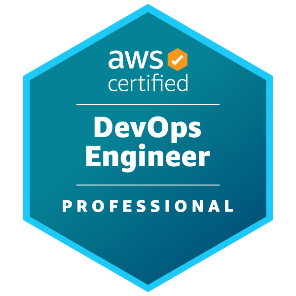
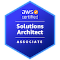
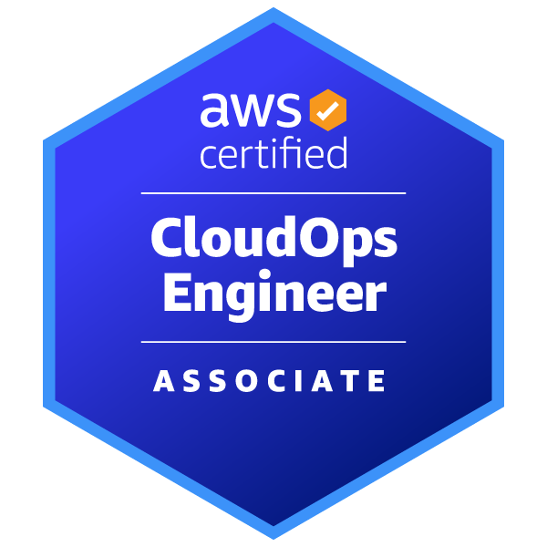
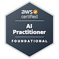
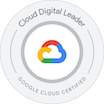
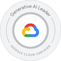

## ☁️ Maria Arpitha Sagayam | Cloud Infrastructure Engineer 

> “Engineering the sky—from concept to cloud, deployment to delivery.”

Hi, I'm Maria Arpitha — a Cloud Engineer with 5+ years of AWS production experience, 7 certifications and hands-on projects built to production standards.

My background includes provisioning, automating, and managing AWS infrastructure using Terraform, building CI/CD pipelines with GitHub Actions, and designing secure multi‑AZ architectures. I gained real production experience at a global EdTech SaaS company serving clients across the US, UK, and Southeast Asia, where I built AWS environments from scratch and supported mission‑critical workloads.

Based in Bristol, CT, I’m open to remote and hybrid roles.
Fully authorized to work in the U.S. (H4 EAD — no sponsorship required).

---

## 🏅🏆 Certifications

---

## 🛠️ Tech Toolbox

-  **Cloud Platforms**: AWS (Primary) · Azure · GCP  
-  **IaC & Automation**: Terraform
-  **CI/CD Pipelines**: GitHub Actions
-  **Containers & Orchestration**: Docker · Amazon ECS (Fargate) · Amazon EKS (Kubernetes)
-  **Security**: IAM · Secrets Manager · KMS · Security Groups  
-  **Monitoring & Observability**: Amazon CloudWatch
-  **Version Control Tools**: Git · GitHub
-  **Scripting**: Bash · Pyhton
-  **Operating Systems**: Linux · Windows
-  **AI Tools**: GitHub Copilot · Claude Code
  
---

## 📈 Career Development

### Hands-on Cloud Projects | Self-Directed | U.S. | Mar 2024 – Present

- Fully authorized to work in the U.S. (H4 EAD — no sponsorship required).
Following relocation to the U.S., dedicated this period to earning 7 cloud certifications across AWS, GCP, and Azure, and building production‑equivalent cloud projects to stay technically current and market‑ready..

1. #### **AWS 3-Tier Production Project - Terraform · Docker · GitHub Actions · Kubernetes · CloudWatch**
- Provisioned a complete 3‑tier AWS architecture using Terraform (VPC, subnets, ALB, EKS, RDS MySQL, IAM) across multiple Availability Zones.
- Built a GitHub Actions CI/CD pipeline: terraform plan on PR, terraform apply on merge, Docker build, ECR push, and automated kubectl rollout.
- Containerized a Node.js application with Docker and pushed images to ECR using IAM role authentication (no stored credentials).
- Migrated compute from EC2/ASG to EKS using Kubernetes Deployment, Service, and Secret for secure DB credential injection.
- Implemented CloudWatch monitoring with metrics, alarms, log streams, and SNS alerting.

2. #### **Zero-Downtime Container Deployments — Docker · ECR · ECS Fargate · ALB · IAM · CloudWatch**
- Containerized a Node.js app and stored it in a private ECR repository with scan‑on‑push enabled.
- Deployed on ECS Fargate behind an ALB across two Availability Zones with security group chaining and target group health checks.
- Validated zero‑downtime rolling updates and automatic rollback using the ECS deployment circuit breaker.
- Configured CloudWatch logging and IAM execution roles for secure operations.

3. #### **Secure Static Website — S3 · CloudFront · ACM · Route 53**
- Hosted a static website on a private S3 bucket served through CloudFront using Origin Access Control (no direct S3 public access).
- Secured the distribution with an ACM SSL certificate.
- Configured a custom domain using Route 53 with full HTTPS support.
  
4. #### **Serverless Credential Rotation — Lambda · Secrets Manager · EventBridge**
- Implemented scheduled credential rotation in Secrets Manager using a Python Lambda function triggered by EventBridge.
- Eliminated manual rotation and reduced risk of stale credentials.
- Applied least‑privilege IAM policies with no standing access to secrets.

---

## 👩‍💻 Professionl Experience

### Configuration Management Engineer — AWS Cloud Infrastructure 
#### 🏢 Excelsoft Technologies Pvt. Ltd · Mysore, India · Jul 2021 – Feb 2023  
- Provisioned and managed production‑grade AWS environments (CAT, UAT, Production) using Terraform for EC2, VPC, subnets, ALB, ASG, RDS MySQL, S3, IAM, and CloudWatch.
- Designed and deployed a 3‑tier architecture — ALB (presentation), EC2 in private subnets (application), RDS MySQL (database) — with full network isolation using security groups and NACLs.
- Developed reusable Terraform modules for networking, compute, and database layers, fully parameterized and version‑controlled in GitHub.
- Created and maintained pre‑configured AMIs to ensure consistent EC2 deployments and eliminate configuration drift across environments.
- Automated EC2 provisioning using Bash‑based user data scripts for instance initialization and configuration.
- Enforced least‑privilege IAM by managing roles, users, policies, and resource‑level permissions across EC2, RDS, and S3.
- Configured CloudWatch metrics, alarms, and log groups to improve production visibility and enable early incident detection.
- Collaborated with cross‑functional teams during production incidents to diagnose infrastructure failures, resolve environment misalignments, and implement preventive fixes.

### Cloud Trainee — AWS 
#### 💻 Indian Institute of Hardware Technology Ltd (IIHT) · Bangalore, India · Jan 2018 – Jun 2021
- Internal deployments — supported internal application deployments, environment setup, and cloud infrastructure tasks using core AWS services.
- Real‑time project collaboration — worked closely with senior cloud architects and engineers on live project work, gaining hands-on experience in production workflows, troubleshooting, and cloud best practices.
- Hands‑on AWS training — delivered practical training to multiple batches of junior engineers, with labs covering EC2, S3, IAM, VPC, RDS, and foundational cloud concepts.
- GitHub version control — used GitHub for version control, maintaining training materials, lab guides, and internal project repositories.
- Technical documentation — created onboarding guides, runbooks, and step‑by‑step lab documentation to accelerate team onboarding and improve operational efficiency.

---

## 🎓 Education

#### Bachelors of Engineering (BE), Information Science & Engineering (ISE)
JSS Academy of Technical Education (JSSATE) — Affiliated to VTU  · Bangalore, India  · 2017

